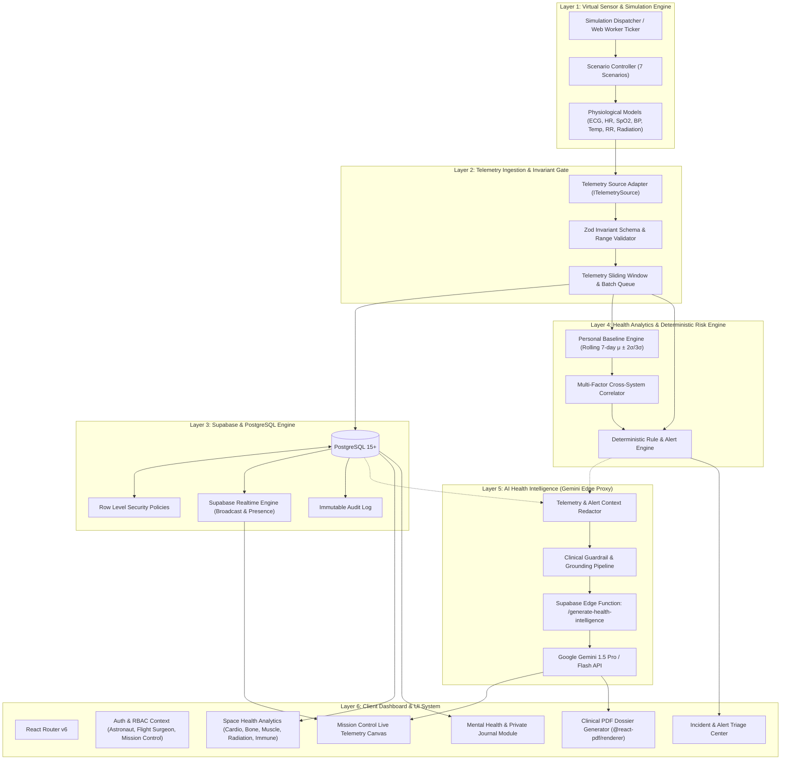
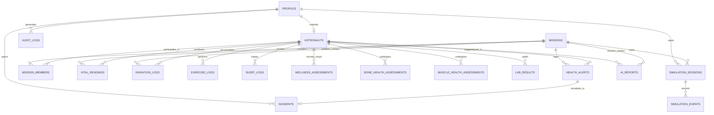
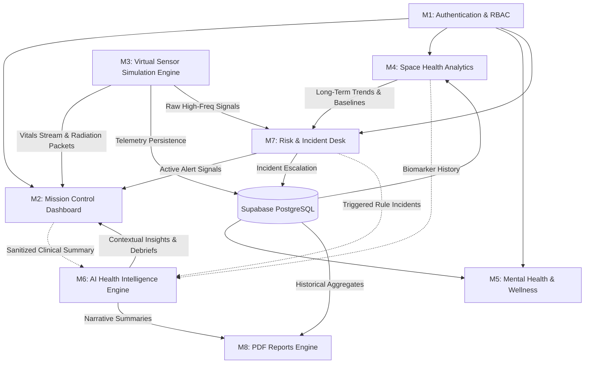
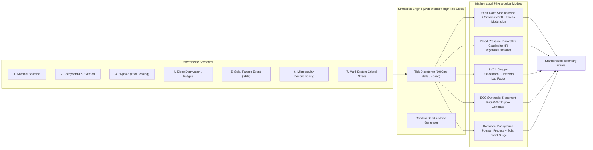
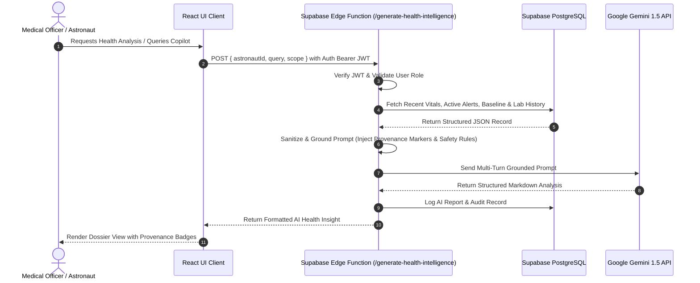
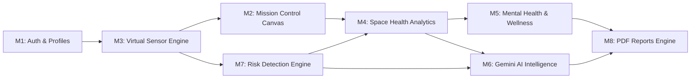

# ASTROCARE: COMPLETE PROJECT ARCHITECTURE & TECHNICAL BLUEPRINT
**Astronaut Health Intelligence & Mission Monitoring System**
*Autonomous Long-Duration Space Mission Health Architecture*

---

## 1. Executive Architecture Overview

AstroCare is an integrated clinical-grade astronaut health monitoring, physiological telemetry, and AI intelligence system designed for simulated deep-space missions (e.g., lunar surface habitats, transit to Mars). Operating in long-duration microgravity presents multi-system physiological challenges: cardiovascular deconditioning, bone mineral density loss, muscle atrophy, space radiation exposure, immune dysregulation, and extreme psychological isolation.

Because physical biometric hardware is unavailable in collegiate hackathon environments, AstroCare implements an enterprise-grade **Pluggable Telemetry Architecture** powered by a software-based **Virtual Sensor & Telemetry Simulation Engine**. The simulation engine models multi-parameter human physiology with mathematical fidelity (sinusoidal baselines, Gaussian variance, circadian rhythmics, and baroreflex coupling).

### Core Architectural Tenets
1. **Separation of Provenance**: Strict, persistent metadata delineation between measured, manually entered, and simulated data (`data_source`, `is_simulated`).
2. **Deterministic Risk Gating**: Medical alerts and risk indicators are evaluated exclusively by deterministic, rule-based threshold and moving-window baseline algorithms. The Google Gemini AI is an explanatory, synthesizing, and conversational intelligence layer; it never acts as a black-box medical diagnostic decider.
3. **Pluggable Telemetry Abstraction**: Downstream modules consume telemetry via a unified `ITelemetrySource` adapter. Real medical wearables (e.g., Hexoskin, Polar, or BioSticker via BLE/WebSocket) can replace the virtual simulator with zero changes to data validation, storage, analytics, or UI layers.
4. **Swiss Editorial + Aerospace Medical Instrumentation UI**: A high-density, typography-driven aesthetic featuring warm ivory (`#F3F0E8`), graphite (`#242824`), sage green (`#738174`), terracotta (`#D16C48`), and critical red (`#B9473E`), avoiding generic dark cyber-themes in favor of clinical dossier precision.

---

## 2. Complete System Architecture Diagram



---

## 3. Technology Stack with Architectural Justification

| Layer | Selected Technology | Architectural Justification |
| :--- | :--- | :--- |
| **Language** | **TypeScript 5.x** | Vital sign parameters cannot afford runtime type coercion errors (e.g., misinterpreting `bpm` as `mmHg` or `mSv`). TypeScript provides compile-time data contract integrity, full sync with Supabase auto-generated database types, and deep IDE autocompletion for complex aerospace telemetry payloads. |
| **Frontend Framework** | **React 18.3+ with Vite** | Vite delivers sub-second Hot Module Replacement (HMR) and optimized Rollup tree-shaking. React's concurrent rendering cleanly handles 10Hz-50Hz waveform streams without locking the main UI thread. |
| **Styling & Design System** | **Tailwind CSS + Custom Tokens** | Highly customizable configuration enables exact implementation of the Swiss Editorial design language (exact color palette tokens, custom typography scales, and ultra-fine border geometry) without CSS bloat. |
| **Iconography** | **Lucide React** | Feather-derived, clean 1.5px/2px stroke icons that match clinical and aerospace instrumentation aesthetics without visual clutter. |
| **Data Visualization** | **Recharts + Native HTML5 Canvas** | Recharts provides declarative, SVG-rendered trend lines for historic cardiovascular, radiation, and exercise tracking. Canvas is utilized specifically for high-frequency (50Hz) real-time ECG rhythm strips to avoid SVG DOM overhead. |
| **Database & Realtime** | **Supabase (PostgreSQL 15+)** | Managed PostgreSQL with native Row Level Security (RLS), full-text search, built-in JSONB support for polymorphic lab records, and zero-latency WebSocket broadcasting via Supabase Realtime. |
| **Authentication & RBAC** | **Supabase Auth** | Built-in JWT tokens containing secure claims; tight integration with PostgreSQL RLS policies; eliminates redundant auth microservice maintenance. |
| **Artificial Intelligence** | **Google Gemini API via Edge Function** | Gemini 1.5 Pro/Flash provides industry-leading reasoning over long context windows (multivariate health histories, cumulative mission dosimetry, lab test correlations) with low latency. Invoked exclusively via backend serverless proxies to prevent client-side credential exposure. |
| **Form & Schema Validation**| **React Hook Form + Zod** | Zod guarantees type-safe schema validation at runtime for both form entries and ingested simulation payloads. React Hook Form minimizes re-renders on high-density medical input forms. |
| **Dossier & Report Output** | **@react-pdf/renderer** | Produces true vector-based, multi-page PDF medical dossiers on the client side with custom typography, tabular logs, and vector charts, avoiding the blurriness and DOM breakages of `html2canvas`. |
| **Deployment** | **Vercel + Supabase Cloud** | Global edge network with immediate preview builds, native Vite support, and zero-cold-start deployment. |

---

## 4. Complete Database Schema (PostgreSQL DDL Specification)

```sql
-- ENABLE REQUIRED EXTENSIONS
CREATE EXTENSION IF NOT EXISTS "uuid-ossp";
CREATE EXTENSION IF NOT EXISTS "pgcrypto";

-- ENUMS FOR STRICT TYPING
CREATE TYPE user_role AS ENUM ('ASTRONAUT', 'MEDICAL_OFFICER', 'MISSION_CONTROLLER');
CREATE TYPE data_source_type AS ENUM ('SIMULATOR', 'MANUAL_ENTRY', 'HARDWARE_STREAM', 'LAB_IMPORT');
CREATE TYPE alert_severity AS ENUM ('LOW', 'MEDIUM', 'HIGH', 'CRITICAL');
CREATE TYPE alert_status AS ENUM ('ACTIVE', 'ACKNOWLEDGED', 'RESOLVED', 'DISMISSED');
CREATE TYPE mission_status AS ENUM ('PLANNING', 'ACTIVE', 'COMPLETED', 'ABORTED');

-- 1. PROFILES TABLE
CREATE TABLE profiles (
    id UUID PRIMARY KEY REFERENCES auth.users(id) ON DELETE CASCADE,
    callsign VARCHAR(50) NOT NULL UNIQUE,
    full_name VARCHAR(100) NOT NULL,
    role user_role NOT NULL DEFAULT 'ASTRONAUT',
    avatar_url TEXT,
    created_at TIMESTAMPTZ NOT NULL DEFAULT NOW(),
    updated_at TIMESTAMPTZ NOT NULL DEFAULT NOW()
);

-- 2. MISSIONS TABLE
CREATE TABLE missions (
    id UUID PRIMARY KEY DEFAULT uuid_generate_v4(),
    code VARCHAR(20) NOT NULL UNIQUE, -- e.g., 'ARES-VI'
    name VARCHAR(100) NOT NULL,
    target_destination VARCHAR(100) NOT NULL, -- e.g., 'Mars Jezero Crater'
    status mission_status NOT NULL DEFAULT 'PLANNING',
    launch_date TIMESTAMPTZ NOT NULL,
    scheduled_end_date TIMESTAMPTZ NOT NULL,
    actual_end_date TIMESTAMPTZ,
    radiation_threshold_limit_msv NUMERIC(6, 2) NOT NULL DEFAULT 500.00,
    created_at TIMESTAMPTZ NOT NULL DEFAULT NOW()
);

-- 3. ASTRONAUTS TABLE
CREATE TABLE astronauts (
    id UUID PRIMARY KEY DEFAULT uuid_generate_v4(),
    profile_id UUID NOT NULL REFERENCES profiles(id) ON DELETE RESTRICT,
    badge_number VARCHAR(30) NOT NULL UNIQUE,
    date_of_birth DATE NOT NULL,
    blood_type VARCHAR(5) NOT NULL,
    height_cm NUMERIC(5, 2) NOT NULL,
    baseline_mass_kg NUMERIC(5, 2) NOT NULL,
    baseline_resting_hr INT NOT NULL DEFAULT 65,
    baseline_bp_systolic INT NOT NULL DEFAULT 115,
    baseline_bp_diastolic INT NOT NULL DEFAULT 75,
    baseline_spo2 INT NOT NULL DEFAULT 98,
    emergency_contact JSONB NOT NULL DEFAULT '{}'::jsonb,
    created_at TIMESTAMPTZ NOT NULL DEFAULT NOW(),
    updated_at TIMESTAMPTZ NOT NULL DEFAULT NOW()
);

-- 4. MISSION_MEMBERS TABLE
CREATE TABLE mission_members (
    id UUID PRIMARY KEY DEFAULT uuid_generate_v4(),
    mission_id UUID NOT NULL REFERENCES missions(id) ON DELETE CASCADE,
    astronaut_id UUID NOT NULL REFERENCES astronauts(id) ON DELETE CASCADE,
    assigned_role VARCHAR(50) NOT NULL, -- Commander, Science Officer, Flight Engineer
    joined_at TIMESTAMPTZ NOT NULL DEFAULT NOW(),
    UNIQUE (mission_id, astronaut_id)
);

-- 5. SIMULATION_SESSIONS TABLE
CREATE TABLE simulation_sessions (
    id UUID PRIMARY KEY DEFAULT uuid_generate_v4(),
    mission_id UUID NOT NULL REFERENCES missions(id) ON DELETE CASCADE,
    scenario_id VARCHAR(50) NOT NULL,
    scenario_name VARCHAR(100) NOT NULL,
    started_by UUID NOT NULL REFERENCES profiles(id),
    time_multiplier NUMERIC(3, 1) NOT NULL DEFAULT 1.0,
    is_active BOOLEAN NOT NULL DEFAULT TRUE,
    started_at TIMESTAMPTZ NOT NULL DEFAULT NOW(),
    ended_at TIMESTAMPTZ
);

-- 6. VITAL_READINGS TABLE (Time-Series Optimized)
CREATE TABLE vital_readings (
    id UUID PRIMARY KEY DEFAULT uuid_generate_v4(),
    astronaut_id UUID NOT NULL REFERENCES astronauts(id) ON DELETE CASCADE,
    mission_id UUID NOT NULL REFERENCES missions(id) ON DELETE CASCADE,
    simulation_session_id UUID REFERENCES simulation_sessions(id) ON DELETE SET NULL,
    timestamp TIMESTAMPTZ NOT NULL,
    data_source data_source_type NOT NULL DEFAULT 'SIMULATOR',
    is_simulated BOOLEAN NOT NULL DEFAULT TRUE,
    heart_rate_bpm INT CHECK (heart_rate_bpm BETWEEN 20 AND 250),
    blood_pressure_systolic INT CHECK (blood_pressure_systolic BETWEEN 50 AND 260),
    blood_pressure_diastolic INT CHECK (blood_pressure_diastolic BETWEEN 30 AND 180),
    spo2_percentage INT CHECK (spo2_percentage BETWEEN 50 AND 100),
    respiratory_rate_rpm INT CHECK (respiratory_rate_rpm BETWEEN 4 AND 60),
    core_temp_celsius NUMERIC(4, 2) CHECK (core_temp_celsius BETWEEN 32.00 AND 43.00),
    ecg_rhythm_strip JSONB, -- Array of millivolt float values: [0.02, 0.05, 0.98, -0.2, 0.01]
    quality_status VARCHAR(20) NOT NULL DEFAULT 'NOMINAL',
    created_at TIMESTAMPTZ NOT NULL DEFAULT NOW()
);

-- 7. RADIATION_LOGS TABLE
CREATE TABLE radiation_logs (
    id UUID PRIMARY KEY DEFAULT uuid_generate_v4(),
    astronaut_id UUID NOT NULL REFERENCES astronauts(id) ON DELETE CASCADE,
    mission_id UUID NOT NULL REFERENCES missions(id) ON DELETE CASCADE,
    timestamp TIMESTAMPTZ NOT NULL,
    data_source data_source_type NOT NULL DEFAULT 'SIMULATOR',
    is_simulated BOOLEAN NOT NULL DEFAULT TRUE,
    dosimeter_id VARCHAR(50) NOT NULL,
    ambient_flux_usv_per_hour NUMERIC(8, 3) NOT NULL,
    accumulated_dose_msv NUMERIC(8, 4) NOT NULL,
    solar_particle_event_active BOOLEAN NOT NULL DEFAULT FALSE,
    radiation_type VARCHAR(30) NOT NULL DEFAULT 'GALACTIC_COSMIC',
    created_at TIMESTAMPTZ NOT NULL DEFAULT NOW()
);

-- 8. EXERCISE_LOGS TABLE
CREATE TABLE exercise_logs (
    id UUID PRIMARY KEY DEFAULT uuid_generate_v4(),
    astronaut_id UUID NOT NULL REFERENCES astronauts(id) ON DELETE CASCADE,
    session_start TIMESTAMPTZ NOT NULL,
    duration_minutes INT NOT NULL CHECK (duration_minutes > 0),
    modality VARCHAR(50) NOT NULL, -- e.g., 'T2_TREADMILL', 'ARED_RESISTANCE', 'CYCLE_ERGOMETER'
    avg_heart_rate_bpm INT NOT NULL,
    peak_heart_rate_bpm INT NOT NULL,
    work_load_joules NUMERIC(10, 2),
    calories_burned_kcal INT,
    resistance_load_kg NUMERIC(6, 2),
    is_simulated BOOLEAN NOT NULL DEFAULT TRUE,
    created_at TIMESTAMPTZ NOT NULL DEFAULT NOW()
);

-- 9. SLEEP_LOGS TABLE
CREATE TABLE sleep_logs (
    id UUID PRIMARY KEY DEFAULT uuid_generate_v4(),
    astronaut_id UUID NOT NULL REFERENCES astronauts(id) ON DELETE CASCADE,
    sleep_start TIMESTAMPTZ NOT NULL,
    sleep_end TIMESTAMPTZ NOT NULL,
    total_sleep_minutes INT NOT NULL,
    rem_minutes INT,
    deep_sleep_minutes INT,
    light_sleep_minutes INT,
    awakenings_count INT NOT NULL DEFAULT 0,
    sleep_quality_score INT CHECK (sleep_quality_score BETWEEN 0 AND 100),
    is_simulated BOOLEAN NOT NULL DEFAULT TRUE,
    created_at TIMESTAMPTZ NOT NULL DEFAULT NOW()
);

-- 10. WELLNESS_ASSESSMENTS TABLE (Mental Health & Journal)
CREATE TABLE wellness_assessments (
    id UUID PRIMARY KEY DEFAULT uuid_generate_v4(),
    astronaut_id UUID NOT NULL REFERENCES astronauts(id) ON DELETE CASCADE,
    timestamp TIMESTAMPTZ NOT NULL DEFAULT NOW(),
    mood_score INT NOT NULL CHECK (mood_score BETWEEN 1 AND 10),
    stress_level INT NOT NULL CHECK (stress_level BETWEEN 1 AND 10),
    fatigue_level INT NOT NULL CHECK (fatigue_level BETWEEN 1 AND 10),
    cognitive_clarity_score INT NOT NULL CHECK (cognitive_clarity_score BETWEEN 1 AND 10),
    private_journal_entry TEXT, -- Encrypted or protected by RLS
    journal_sentiment VARCHAR(30),
    share_with_medical_officer BOOLEAN NOT NULL DEFAULT FALSE,
    is_simulated BOOLEAN NOT NULL DEFAULT FALSE,
    created_at TIMESTAMPTZ NOT NULL DEFAULT NOW()
);

-- 11. BONE_HEALTH_ASSESSMENTS TABLE
CREATE TABLE bone_health_assessments (
    id UUID PRIMARY KEY DEFAULT uuid_generate_v4(),
    astronaut_id UUID NOT NULL REFERENCES astronauts(id) ON DELETE CASCADE,
    assessment_date DATE NOT NULL,
    measurement_modality VARCHAR(50) NOT NULL DEFAULT 'DXA_SCAN_SIMULATED',
    femoral_neck_bmd_g_cm2 NUMERIC(4, 3) NOT NULL,
    lumbar_spine_bmd_g_cm2 NUMERIC(4, 3) NOT NULL,
    t_score NUMERIC(3, 1) NOT NULL,
    z_score NUMERIC(3, 1) NOT NULL,
    percentage_loss_from_baseline NUMERIC(4, 2) NOT NULL DEFAULT 0.00,
    notes TEXT,
    is_simulated BOOLEAN NOT NULL DEFAULT TRUE,
    created_at TIMESTAMPTZ NOT NULL DEFAULT NOW()
);

-- 12. MUSCLE_HEALTH_ASSESSMENTS TABLE
CREATE TABLE muscle_health_assessments (
    id UUID PRIMARY KEY DEFAULT uuid_generate_v4(),
    astronaut_id UUID NOT NULL REFERENCES astronauts(id) ON DELETE CASCADE,
    assessment_date DATE NOT NULL,
    isometric_grip_strength_kg NUMERIC(4, 1) NOT NULL,
    quadriceps_peak_torque_nm NUMERIC(5, 1) NOT NULL,
    calf_circumference_cm NUMERIC(4, 1) NOT NULL,
    percentage_strength_loss NUMERIC(4, 2) NOT NULL DEFAULT 0.00,
    evaluator_id UUID REFERENCES profiles(id),
    is_simulated BOOLEAN NOT NULL DEFAULT TRUE,
    created_at TIMESTAMPTZ NOT NULL DEFAULT NOW()
);

-- 13. LAB_RESULTS TABLE (Immune & Hematology)
CREATE TABLE lab_results (
    id UUID PRIMARY KEY DEFAULT uuid_generate_v4(),
    astronaut_id UUID NOT NULL REFERENCES astronauts(id) ON DELETE CASCADE,
    sample_collected_at TIMESTAMPTZ NOT NULL,
    test_type VARCHAR(50) NOT NULL, -- 'CBC_IMMUNE_PANEL', 'CYTOKINE_PROFILE', 'SALIVARY_CORTISOL'
    wbc_count_10e3_ul NUMERIC(5, 2), -- Normal 4.5 - 11.0
    lymphocytes_percentage NUMERIC(4, 1),
    neutrophils_percentage NUMERIC(4, 1),
    crp_mg_l NUMERIC(5, 2), -- C-reactive protein
    cortisol_ug_dl NUMERIC(5, 2),
    raw_panel_json JSONB NOT NULL DEFAULT '{}'::jsonb,
    is_simulated BOOLEAN NOT NULL DEFAULT TRUE,
    created_at TIMESTAMPTZ NOT NULL DEFAULT NOW()
);

-- 14. HEALTH_ALERTS TABLE (Deterministic Engine)
CREATE TABLE health_alerts (
    id UUID PRIMARY KEY DEFAULT uuid_generate_v4(),
    mission_id UUID NOT NULL REFERENCES missions(id) ON DELETE CASCADE,
    astronaut_id UUID NOT NULL REFERENCES astronauts(id) ON DELETE CASCADE,
    timestamp TIMESTAMPTZ NOT NULL DEFAULT NOW(),
    rule_code VARCHAR(50) NOT NULL, -- e.g., 'CARDIO_TACHYCARDIA_SUSTAINED'
    severity alert_severity NOT NULL,
    status alert_status NOT NULL DEFAULT 'ACTIVE',
    title VARCHAR(150) NOT NULL,
    description TEXT NOT NULL,
    triggering_value VARCHAR(100) NOT NULL,
    baseline_expected VARCHAR(100),
    acknowledged_by UUID REFERENCES profiles(id),
    acknowledged_at TIMESTAMPTZ,
    resolution_notes TEXT,
    created_at TIMESTAMPTZ NOT NULL DEFAULT NOW()
);

-- 15. INCIDENTS TABLE
CREATE TABLE incidents (
    id UUID PRIMARY KEY DEFAULT uuid_generate_v4(),
    mission_id UUID NOT NULL REFERENCES missions(id) ON DELETE CASCADE,
    astronaut_id UUID REFERENCES astronauts(id) ON DELETE SET NULL,
    alert_id UUID REFERENCES health_alerts(id) ON DELETE SET NULL,
    incident_number VARCHAR(30) NOT NULL UNIQUE, -- e.g., 'INC-2026-004'
    title VARCHAR(200) NOT NULL,
    severity alert_severity NOT NULL,
    root_cause_category VARCHAR(50) NOT NULL, -- Cardiovascular, Environmental, Psychosocial
    status VARCHAR(30) NOT NULL DEFAULT 'INVESTIGATING',
    opened_by UUID NOT NULL REFERENCES profiles(id),
    opened_at TIMESTAMPTZ NOT NULL DEFAULT NOW(),
    closed_at TIMESTAMPTZ,
    action_log JSONB NOT NULL DEFAULT '[]'::jsonb
);

-- 16. AI_REPORTS TABLE
CREATE TABLE ai_reports (
    id UUID PRIMARY KEY DEFAULT uuid_generate_v4(),
    astronaut_id UUID NOT NULL REFERENCES astronauts(id) ON DELETE CASCADE,
    mission_id UUID NOT NULL REFERENCES missions(id) ON DELETE CASCADE,
    report_type VARCHAR(50) NOT NULL, -- 'DAILY_BRIEF', 'ANOMALY_EXPLANATION', 'MISSION_SUMMARY'
    generated_at TIMESTAMPTZ NOT NULL DEFAULT NOW(),
    prompt_context_summary TEXT NOT NULL,
    ai_response_markdown TEXT NOT NULL,
    model_version VARCHAR(50) NOT NULL,
    disclaimer_acknowledged BOOLEAN NOT NULL DEFAULT TRUE,
    citations_json JSONB NOT NULL DEFAULT '[]'::jsonb
);

-- 17. SIMULATION_EVENTS TABLE
CREATE TABLE simulation_events (
    id UUID PRIMARY KEY DEFAULT uuid_generate_v4(),
    session_id UUID NOT NULL REFERENCES simulation_sessions(id) ON DELETE CASCADE,
    event_timestamp TIMESTAMPTZ NOT NULL,
    event_type VARCHAR(50) NOT NULL, -- 'PARAM_MODULATION', 'SOLAR_FLARE_INJECTION', 'ARRHYTHMIA_TRIGGER'
    payload JSONB NOT NULL,
    created_at TIMESTAMPTZ NOT NULL DEFAULT NOW()
);

-- 18. AUDIT_LOGS TABLE (Immutable Log)
CREATE TABLE audit_logs (
    id UUID PRIMARY KEY DEFAULT uuid_generate_v4(),
    user_id UUID REFERENCES profiles(id),
    action VARCHAR(50) NOT NULL,
    entity_name VARCHAR(50) NOT NULL,
    entity_id UUID NOT NULL,
    ip_address VARCHAR(45),
    details JSONB NOT NULL DEFAULT '{}'::jsonb,
    created_at TIMESTAMPTZ NOT NULL DEFAULT NOW()
);

-- =========================================================================
-- OPTIMIZED PERFORMANCE INDEXES
-- =========================================================================
CREATE INDEX idx_vital_readings_astro_time ON vital_readings(astronaut_id, timestamp DESC);
CREATE INDEX idx_vital_readings_mission_time ON vital_readings(mission_id, timestamp DESC);
CREATE INDEX idx_radiation_logs_astro_time ON radiation_logs(astronaut_id, timestamp DESC);
CREATE INDEX idx_radiation_logs_mission_time ON radiation_logs(mission_id, timestamp DESC);
CREATE INDEX idx_health_alerts_active ON health_alerts(mission_id, status) WHERE status = 'ACTIVE';
CREATE INDEX idx_health_alerts_astro ON health_alerts(astronaut_id, timestamp DESC);
CREATE INDEX idx_exercise_logs_astro ON exercise_logs(astronaut_id, session_start DESC);
CREATE INDEX idx_wellness_astro_time ON wellness_assessments(astronaut_id, timestamp DESC);
CREATE INDEX idx_audit_logs_user_time ON audit_logs(user_id, created_at DESC);

-- =========================================================================
-- ROW LEVEL SECURITY (RLS) POLICIES
-- =========================================================================
ALTER TABLE profiles ENABLE ROW LEVEL SECURITY;
ALTER TABLE astronauts ENABLE ROW LEVEL SECURITY;
ALTER TABLE vital_readings ENABLE ROW LEVEL SECURITY;
ALTER TABLE wellness_assessments ENABLE ROW LEVEL SECURITY;
ALTER TABLE health_alerts ENABLE ROW LEVEL SECURITY;
ALTER TABLE incidents ENABLE ROW LEVEL SECURITY;
ALTER TABLE ai_reports ENABLE ROW LEVEL SECURITY;

-- Helper function to fetch executing user's role
CREATE OR REPLACE FUNCTION get_current_user_role()
RETURNS user_role AS $$
    SELECT role FROM profiles WHERE id = auth.uid();
$$ LANGUAGE sql STABLE SECURITY DEFINER;

-- Profiles: Users can view all profiles in mission; only edit own
CREATE POLICY "Public profiles are readable by authenticated users"
ON profiles FOR SELECT TO authenticated USING (true);

CREATE POLICY "Users can update own profile"
ON profiles FOR UPDATE TO authenticated USING (auth.uid() = id);

-- Wellness Assessments: Privacy Protection
-- Astronauts can read and write only their own entries
-- Medical Officers can read only if share_with_medical_officer = true
-- Mission Controllers CANNOT read private journals
CREATE POLICY "Astronauts have full access to own wellness journals"
ON wellness_assessments FOR ALL TO authenticated
USING (astronaut_id IN (SELECT id FROM astronauts WHERE profile_id = auth.uid()));

CREATE POLICY "Medical Officers can view consented wellness entries"
ON wellness_assessments FOR SELECT TO authenticated
USING (
    get_current_user_role() = 'MEDICAL_OFFICER' 
    AND share_with_medical_officer = true
);

-- Vital Readings: Read by all mission members; Medical Officers & System can insert
CREATE POLICY "Authenticated users can read vital readings"
ON vital_readings FOR SELECT TO authenticated USING (true);

CREATE POLICY "Medical Officers and System can insert readings"
ON vital_readings FOR INSERT TO authenticated
WITH CHECK (
    get_current_user_role() IN ('MEDICAL_OFFICER', 'MISSION_CONTROLLER')
    OR is_simulated = true
);
```

---

## 5. Entity-Relationship Diagram (ERD)



---

## 6. Standardized Telemetry Data Contract

To prevent module desynchronization, every telemetry provider and consumer must strictly adhere to the standardized schema defined in `@/types/telemetry.ts`.

```typescript
// Telemetry Invariant TypeScript Interfaces

export type DataSourceType = 'SIMULATOR' | 'MANUAL_ENTRY' | 'HARDWARE_STREAM' | 'LAB_IMPORT';
export type QualityStatus = 'NOMINAL' | 'DEGRADED_SIGNAL' | 'OUT_OF_BOUNDS' | 'SENSOR_DISCONNECTED';

export type MeasurementType = 
  | 'HEART_RATE'
  | 'SPO2'
  | 'BLOOD_PRESSURE_SYS'
  | 'BLOOD_PRESSURE_DIA'
  | 'CORE_TEMP'
  | 'RESPIRATORY_RATE'
  | 'RADIATION_FLUX'
  | 'ECG_WAVEFORM';

export interface MeasurementUnitMap {
  HEART_RATE: 'bpm';
  SPO2: '%';
  BLOOD_PRESSURE_SYS: 'mmHg';
  BLOOD_PRESSURE_DIA: 'mmHg';
  CORE_TEMP: '°C';
  RESPIRATORY_RATE: 'rpm';
  RADIATION_FLUX: 'uSv/h';
  ECG_WAVEFORM: 'mV';
}

/**
 * Atomic Single Measurement Contract
 */
export interface SingleTelemetryMeasurement<T extends MeasurementType = MeasurementType> {
  readingId: string;
  astronautId: string;
  missionId: string;
  timestamp: string; // ISO 8601 UTC
  dataSource: DataSourceType;
  isSimulated: boolean;
  measurementType: T;
  value: number;
  unit: MeasurementUnitMap[T];
  qualityStatus: QualityStatus;
}

/**
 * Grouped Vital Signs Telemetry Packet (Broadcast Frame)
 */
export interface VitalSignsPacket {
  packetId: string;
  astronautId: string;
  missionId: string;
  timestamp: string; // ISO 8601 UTC
  dataSource: DataSourceType;
  isSimulated: boolean;
  vitals: {
    heartRate: { value: number; unit: 'bpm'; quality: QualityStatus };
    bloodPressure: { systolic: number; diastolic: number; unit: 'mmHg'; quality: QualityStatus };
    spo2: { value: number; unit: '%'; quality: QualityStatus };
    respiratoryRate: { value: number; unit: 'rpm'; quality: QualityStatus };
    coreTemp: { value: number; unit: '°C'; quality: QualityStatus };
    ecgStrip?: { values: number[]; sampleRateHz: number };
  };
}

/**
 * Environmental Radiation Telemetry Packet
 */
export interface RadiationPacket {
  packetId: string;
  astronautId: string;
  missionId: string;
  timestamp: string;
  dataSource: DataSourceType;
  isSimulated: boolean;
  ambientFluxUsVh: number;
  accumulatedDoseMSv: number;
  solarParticleEventActive: boolean;
  quality: QualityStatus;
}

/**
 * Pluggable Telemetry Adapter Interface
 * Allows seamless replacement of Virtual Simulator with Hardware Streams
 */
export interface ITelemetrySource {
  init(): Promise<void>;
  startStream(astronautId: string, intervalMs: number): void;
  stopStream(): void;
  onPacketReceived(callback: (packet: VitalSignsPacket) => void): () => void;
  onRadiationReceived(callback: (packet: RadiationPacket) => void): () => void;
  setScenario?(scenarioId: string): void;
  setSpeedMultiplier?(speed: number): void;
}
```

---

## 7. Recommended Frontend Folder Structure

```
c:\Users\ASUS\OneDrive\Desktop\AstroCare\
├── public/
│   ├── favicon.svg
│   └── fonts/
├── src/
│   ├── assets/
│   │   └── brand/                # Insignia, NASA/ESA-inspired technical marks
│   ├── components/
│   │   ├── common/               # Swiss Editorial Design System Atoms
│   │   │   ├── Badge.tsx         # Restrained state pill
│   │   │   ├── Button.tsx        # Sharp, precision buttons
│   │   │   ├── DossierCard.tsx   # Hairline-bordered technical container
│   │   │   ├── MetricDisplay.tsx # IBM Plex Mono reading with unit & delta
│   │   │   ├── Divider.tsx       # Thin clinical line separator
│   │   │   └── Modal.tsx
│   │   ├── layout/               # High-order application frames
│   │   │   ├── AppHeader.tsx     # Mission clock, MET counter, alert beacon
│   │   │   ├── AppSidebar.tsx    # Technical navigational taxonomy
│   │   │   ├── Breadcrumb.tsx
│   │   │   └── RoleGuard.tsx     # Authorization view interceptor
│   │   └── visualization/        # Specialized scientific graphics
│   │       ├── EcgOscilloscope.tsx# HTML5 Canvas 50Hz sweep renderer
│   │       ├── TrendChart.tsx    # Recharts wrapper with Swiss gridlines
│   │       └── RadiationGauge.tsx
│   ├── features/                 # Modular domain slices
│   │   ├── auth/                 # Module 1: Auth & Role Management
│   │   │   ├── components/
│   │   │   ├── hooks/
│   │   │   └── pages/
│   │   ├── dashboard/            # Module 2: Mission Control Overview
│   │   ├── simulation/           # Module 3: Virtual Sensor & Controls
│   │   │   ├── engine/           # Math models, sine generators, noise
│   │   │   ├── scenarios/        # 7 distinct mission scenarios
│   │   │   └── components/       # Scenario switcher, speed dials
│   │   ├── analytics/            # Module 4: Space Health Analytics
│   │   │   ├── cardiovascular/
│   │   │   ├── bone/
│   │   │   ├── muscle/
│   │   │   ├── immune/
│   │   │   └── radiation/
│   │   ├── wellness/             # Module 5: Mental Health & Journals
│   │   ├── ai-intelligence/      # Module 6: Gemini Health Intelligence
│   │   │   ├── components/       # Contextual prompt panel, AI debrief
│   │   │   └── services/         # Edge function proxy callers
│   │   ├── alerts/               # Module 7: Risk Detection & Incident Desk
│   │   │   ├── rules/            # Deterministic evaluation algorithms
│   │   │   └── components/       # Incident desk, acknowledgement modal
│   │   └── reports/              # Module 8: Health Dossiers & PDF Output
│   │       └── pdf/              # @react-pdf/renderer document templates
│   ├── hooks/                    # Shared hooks (useSupabase, useRealtime)
│   ├── services/                 # Infrastructure adapters & API clients
│   │   ├── supabaseClient.ts
│   │   ├── telemetryAdapter.ts   # Concrete ITelemetrySource implementation
│   │   └── riskEngineService.ts  # Deterministic alert trigger service
│   ├── styles/
│   │   ├── index.css             # Tailwind base & custom typography
│   │   └── theme.ts              # Design tokens (Ivory, Graphite, Terracotta)
│   ├── types/                    # Standardized data contracts & DTOs
│   │   ├── database.types.ts     # Auto-generated Supabase schema types
│   │   └── telemetry.ts          # VitalSignsPacket, ITelemetrySource
│   ├── utils/                    # Pure math, date (MET calculation), formatters
│   ├── App.tsx
│   └── main.tsx
├── supabase/
│   ├── functions/
│   │   └── generate-health-intelligence/ # Gemini API Serverless Proxy
│   │       └── index.ts
│   └── migrations/               # DDL migration scripts
├── tailwind.config.js
├── tsconfig.json
└── vite.config.ts
```

---

## 8. Module Dependency & Interaction Diagram



---

## 9. API and Service Interface Plan

### Module 1: Authentication & User Management
- **Consumes**: Supabase Auth sessions, login credentials.
- **Produces**: Authenticated JWT token containing user profile and role (`ASTRONAUT`, `MEDICAL_OFFICER`, `MISSION_CONTROLLER`).
- **Exported Service**: `authService.getCurrentSession()`, `authService.getRole()`, `authService.signIn()`.

### Module 2: Mission Control Dashboard
- **Consumes**: Real-time telemetry via `ITelemetrySource`, active alert counts from Module 7, astronaut list from Module 1.
- **Produces**: Mission Elapsed Time (MET), aggregate crew readiness index, composite health heatmaps.
- **Exported Service**: Reactive UI state subscriber.

### Module 3: Virtual Sensor & Telemetry Simulation Engine
- **Consumes**: Scenario selection, speed factor, astronaut target ID.
- **Produces**: 1Hz `VitalSignsPacket`, 50Hz ECG millivolt floats, 0.1Hz `RadiationPacket`.
- **Exported Service**: `simulationEngine.setScenario(scenarioId)`, `simulationEngine.start()`, `simulationEngine.pause()`.

### Module 4: Space Health Analytics
- **Consumes**: Historical `vital_readings`, `radiation_logs`, `bone_health_assessments`, `muscle_health_assessments`, `lab_results`.
- **Produces**: Long-term organ-system degradation slopes, cumulative radiation dosage vs NASA limits, bone loss percentages.
- **Exported Service**: `analyticsService.getCardiovascularTrends()`, `analyticsService.getCumulativeRadiationDose()`.

### Module 5: Mental Health & Wellness
- **Consumes**: User mood entries, sleep duration from Module 3/wearables.
- **Produces**: Weekly psychological resilience score, sleep efficiency index, encrypted private diary logs.
- **Exported Service**: `wellnessService.submitCheckIn()`, `wellnessService.getTrends()`.

### Module 6: AI Health Intelligence Engine (Gemini)
- **Consumes**: Verified telemetry extracts, active alerts from Module 7, de-identified lab records.
- **Produces**: Contextual explanations of anomalies, astronaut daily briefing syntheses, operational lifestyle countermeasures.
- **Exported Service**: `aiIntelligenceService.queryCopilot(query, contextPayload)`, `aiIntelligenceService.generateMissionHealthBrief(astronautId)`.

### Module 7: Risk Detection & Alert Management
- **Consumes**: Raw real-time telemetry from Module 3, rolling personal baseline metrics from Module 4.
- **Produces**: Tiered `HealthAlert` events (`LOW`, `MEDIUM`, `HIGH`, `CRITICAL`), automated incident creation.
- **Exported Service**: `riskEngine.evaluate(packet, baseline)`, `riskEngine.acknowledgeAlert(alertId)`.

### Module 8: Health Reports & Mission Analytics
- **Consumes**: Data from all modules (vitals, radiation, exercise, AI summaries).
- **Produces**: Downloadable, print-ready vector PDF clinical dossiers.
- **Exported Service**: `reportGenerator.buildDossierPdf(astronautId, dateRange)`.

---

## 10. Authentication and Authorization Plan

### Role-Based Access Matrix

| Feature / Resource | Astronaut | Medical Officer (Flight Surgeon) | Mission Controller |
| :--- | :---: | :---: | :---: |
| **View Mission Overview** | ✅ | ✅ | ✅ |
| **View Own Realtime Vitals** | ✅ | ✅ | ✅ (Aggregated/Redacted) |
| **View Crew Realtime Vitals** | ❌ (Own only) | ✅ (All Crew) | ✅ (Telemetry status only) |
| **Control Simulation Scenarios** | ❌ | ✅ | ✅ |
| **Submit Private Wellness Journal**| ✅ (Author) | ❌ (Unless shared by astronaut) | ❌ Strictly Prohibited |
| **Acknowledge/Resolve Alerts** | ❌ | ✅ | ✅ |
| **Edit Clinical Records / Labs** | ❌ | ✅ | ❌ |
| **Access AI Intelligence Query** | ✅ (Personal) | ✅ (Full Crew Context) | ✅ (Operational Summary) |
| **Generate Full Clinical PDF** | ✅ (Own) | ✅ (Full Crew Dossier) | ✅ (Executive Summary) |

### Cryptographic Security & Key Management
1. **Gemini API Key Protection**: The Google Gemini API key is stored exclusively in Supabase Vault / Edge Function Environment Variables (`GEMINI_API_KEY`). The browser client calls `supabase.functions.invoke('generate-health-intelligence')` passing the user's Supabase auth JWT. The edge function verifies authorization before calling Google's API.
2. **Supabase Service Role Key**: Never bundled into client Vite code. Client only receives the public `SUPABASE_ANON_KEY`, gated by Row Level Security.

---

## 11. Virtual Sensor Simulation Architecture



### Supported Scenarios Table
1. **Scenario 1: Nominal Baseline**: Rest HR 60-70 bpm, BP 115/75, SpO2 98-99%, normal sinus rhythm, ambient radiation 0.05 uSv/h.
2. **Scenario 2: Tachycardia & Heat Exhaustion**: HR increases to 145 bpm, BP rises to 140/90, core temp drifts to 38.6°C.
3. **Scenario 3: Hypoxia / EVA Suit Malfunction**: SpO2 degrades progressively from 98% down to 84%, RR increases compensatorily to 28 rpm.
4. **Scenario 4: Chronic Sleep Deprivation**: Cognitive fatigue, elevated resting cortisol, micro-awakenings, mood score drop.
5. **Scenario 5: Solar Particle Event (SPE)**: Ambient radiation flux jumps from 0.05 uSv/h to 12.5 uSv/h; accumulated dose tracker alarms.
6. **Scenario 6: Microgravity Musculoskeletal Deconditioning**: 60-day accelerated bone density loss and calf circumference reduction.
7. **Scenario 7: Multi-System Emergency**: Hypoxia combined with severe tachycardia and high radiation flux during extravehicular activity.

---

## 12. Risk Detection & Alert Management Architecture

The Risk Engine operates deterministically in real-time. It evaluates every incoming packet in two stages:

### Stage 1: Absolute Critical Thresholds
- Severe Tachycardia: $HR > 130$ bpm sustained for $> 30$ seconds.
- Severe Bradycardia: $HR < 45$ bpm.
- Acute Hypoxia: $SpO_2 < 90\%$.
- Acute Hypertension: $Systolic > 160$ mmHg or $Diastolic > 105$ mmHg.
- Hyperthermia: $CoreTemp > 38.5^\circ\text{C}$.
- Acute Solar Radiation Surge: $Flux > 5.0\,\mu\text{Sv/h}$.

### Stage 2: Moving Window Personal Baseline Anomaly Detection
Using a rolling window of the astronaut's last 50 nominal measurements:
$$\mu = \frac{1}{N}\sum_{i=1}^N x_i, \quad \sigma = \sqrt{\frac{1}{N}\sum_{i=1}^N (x_i - \mu)^2}$$
- Warning ($MEDIUM$ Severity): Value deviates $|x - \mu| > 2\sigma$.
- Critical ($HIGH$ Severity): Value deviates $|x - \mu| > 3\sigma$.

### Multi-Factor Anomaly Correlation
- **Cardiovascular + Hypoxia Shock**: $HR > (\mu_{HR} + 2\sigma) \land SpO_2 < 92\%$ triggers an immediate `HIGH` severity `RESPIRATORY_DECOMPENSATION` alert.
- **Radiation + Immune Suppression**: Cumulative dose $> 100\,\text{mSv} \land WBC < 4.0\times 10^3/\mu\text{L}$ flags an `IMMUNOLOGICAL_RISK_SURGE`.

---

## 13. AI Health Intelligence Architecture (Google Gemini)



### Strict Clinical & Provenance Rules
1. **Provenance Citations**: Every sentence referencing data must prefix or tag the source: `[SIMULATED_TELEMETRY]`, `[RECORDED_LAB]`, `[RULE_ALERT]`, or `[AI_SYNTHESIS]`.
2. **Diagnostic Disclaimer**: The AI system prompt strictly mandates:
   > *"You are the AstroCare Medical Intelligence Assistant. You provide physiological trend analysis, explain operational risk factors, and suggest mission-countermeasures based on NASA flight surgeon protocols. You DO NOT provide definitive clinical diagnoses or prescribe pharmacological treatments. All simulated readings must be explicitly noted."*

---

## 14. Visual Identity & Design System Implementation

The application strictly implements **Swiss Editorial Design + Premium Aerospace Medical Instrumentation**:

### Color Palette Tokens
- **Canvas / Background**: Warm Ivory `#F3F0E8`
- **Primary Ink / Typography**: Deep Graphite `#242824`
- **Secondary Ink / Metadata**: Slate Charcoal `#4A524A`
- **Accent Muted**: Sage Green `#738174`
- **Accent Structural**: Sandstone `#D8CBAF`
- **Accent Warm / Warning**: Terracotta `#D16C48`
- **Critical / Emergency**: Deep Alert Red `#B9473E`
- **Borders / Separators**: Precision Hairline `#D9D4C7` (1px solid)

### Typography Hierarchy
- **Header & Display Typeface**: `Manrope` (Clean geometric neo-grotesque, weights 600, 700, 800)
- **Body & Clinical Narrative**: `Inter` (Optimized legibility, weights 400, 500)
- **Telemetry & Technical Units**: `IBM Plex Mono` (Tabular figures, weights 500, 600)

### UI Architectural Conventions
- Hairline 1px borders, 0px or subtle 4px rounded corners (no bubbly pill containers).
- High whitespace-to-content ratio reflecting Swiss typographic grids.
- Distinct medical dossier cards with technical headers (e.g., `REF: MED-ARES-04 // MET: 142:18:22`).
- Asymmetrical two-column and three-column editorial layouts with clinical precision.

---

## 15. Development Sequence & Verification Roadmap



### Module Verification Breakdown
1. **M1 (Auth & RBAC)**: Verify RLS restricts astronauts from viewing other crew's private records; flight surgeons access full crew.
2. **M3 (Virtual Sensor)**: Verify 7 scenarios trigger expected mathematical trends; verify `ITelemetrySource` can be toggled without app crash.
3. **M2 (Dashboard)**: Verify 1Hz telemetry updates render smoothly without layout jank; check MET mission clock.
4. **M7 (Risk Detection)**: Unit test deterministic rules with synthetic boundary cases ($SpO_2=89$, $HR=135$).
5. **M4 (Analytics)**: Verify multi-day trend graphs for bone, muscle, cardio, and radiation limits against NASA guidelines.
6. **M5 (Wellness)**: Verify mood check-in persistence and strict private journal isolation.
7. **M6 (AI Intelligence)**: Test Gemini integration via edge proxy; verify safety guardrails trigger on diagnostic prompts.
8. **M8 (PDF Reports)**: Verify vector PDF generation with correct pagination, charts, and metadata.

---

## 16. Technical Risks & Mitigation Strategies

| Risk | Impact | Architectural Mitigation Strategy |
| :--- | :---: | :--- |
| **High-Frequency WebSocket Overhead** | High | Buffer real-time 50Hz ECG data on the client using HTML5 Canvas rendering. Send only downsampled 1Hz aggregated summaries to the PostgreSQL database to prevent database connection saturation. |
| **AI Medical Hallucination** | Critical | Ground Gemini prompts with strict JSON context payloads containing only verified telemetry and rule-engine alerts. Enforce explicit provenance badges (`[SIMULATED]`, `[OBSERVED]`) and enforce strict non-diagnostic system prompts. |
| **Data Structure Drift Between Modules** | High | Centralize all telemetry definitions in `@/types/telemetry.ts` and runtime Zod schemas. Disallow module-specific custom data structures. |
| **Simulated vs Real Telemetry Coupling** | Medium | Utilize the `ITelemetrySource` adapter pattern. The rest of the application interacts only with standard `VitalSignsPacket` interfaces. |
| **Sensitive Journal Privacy Breach** | Critical | Enforce database-level PostgreSQL Row Level Security (RLS) on `wellness_assessments`. Flight controllers and unconsented medical personnel are blocked by the database engine regardless of client logic. |

---
*Blueprint formulated and verified for AstroCare Autonomous Mission Architecture.*
