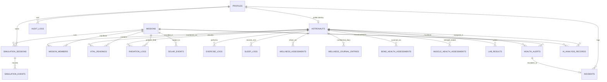

# ASTROCARE DATABASE SCHEMA & DATA LAYER SPECIFICATION
**Document Reference:** `ASTRO-DB-2026-REV-1.0`  
**Classification:** Database Architecture & RLS Security Standard  
**Backend Engine:** Supabase PostgreSQL 15+ & Standalone Demo Provider  

---

## 1. Database Architecture Overview

AstroCare utilizes a normalized PostgreSQL database designed for high-density physiological time-series ingestion, mission-wide clinical records, and cryptographic user privacy. The schema is organized into 9 domain functional clusters comprising 20 normalized tables.



---

## 2. Table Catalog & Column Specifications

### Cluster A: User & Identity
1. **`profiles`**: Extends `auth.users` with callsign, full name, role (`ASTRONAUT`, `MEDICAL_OFFICER`, `MISSION_CONTROLLER`), and avatar.
   - Primary Key: `id` (UUID, references `auth.users.id`).
   - Constraints: `callsign UNIQUE`.

### Cluster B: Mission Operations
2. **`missions`**: Mission metadata, target destination, launch date, scheduled return, and biological radiation threshold ($500.0\,\text{mSv}$).
   - Primary Key: `id` (UUID).
   - Constraints: `code UNIQUE`.
3. **`astronauts`**: Flight medical parameters, badge number, blood type, mass, baseline resting vitals (HR, BP, SpO2).
   - Primary Key: `id` (UUID).
   - Foreign Key: `profile_id` references `profiles(id)`.
4. **`mission_members`**: Join table binding astronauts to active missions with operational roles (e.g. Commander, Flight Surgeon).
   - Unique: `(mission_id, astronaut_id)`.

### Cluster C: Physiological Telemetry
5. **`telemetry_sources`**: Registry of sensor origins (`SIMULATOR`, `HARDWARE_STREAM`, `MANUAL_ENTRY`, `LAB_IMPORT`).
6. **`vital_readings`**: High-frequency physiological readings.
   - Columns: `id`, `astronaut_id`, `mission_id`, `timestamp`, `data_source`, `is_simulated`, `heart_rate_bpm`, `blood_pressure_systolic`, `blood_pressure_diastolic`, `spo2_percentage`, `respiratory_rate_rpm`, `core_temp_celsius`, `ecg_rhythm_strip` (JSONB array), `quality_status`.
   - Constraints: Check constraints enforce strict biological limits ($HR \in [20, 250]$, $SpO_2 \in [50, 100]$, $Temp \in [32, 43]$).
   - Indexes: Compound index on `(astronaut_id, timestamp DESC)` and `(mission_id, timestamp DESC)`.

### Cluster D: Environmental Dosimetry
7. **`radiation_logs`**: Ambient dosimeter readings, absorbed dose, solar flare activity flag.
   - Columns: `dosimeter_id`, `ambient_flux_usv_per_hour`, `accumulated_dose_msv`, `solar_particle_event_active`, `radiation_type`.
8. **`solar_events`**: Coronal mass ejections and solar particle events with peak flux and countermeasures taken.

### Cluster E: Space Health Assessments
9. **`bone_health_assessments`**: In-flight DXA scans, femoral neck and lumbar spine BMD, T/Z scores, percent loss.
10. **`muscle_health_assessments`**: Grip strength, peak quadriceps torque, calf circumference, percent loss.
11. **`lab_results`**: In-flight hematology, white blood cell counts, neutrophil/lymphocyte ratios, salivary cortisol, CRP.
12. **`exercise_logs`**: Countermeasure workouts (ARED resistance, T2 treadmill, cycle ergometer), workload, heart rate response.

### Cluster F: Mental Wellness & Private Journal
13. **`wellness_assessments`**: Daily scores (mood 1–10, stress 1–10, fatigue 1–10, cognitive clarity 1–10).
14. **`sleep_logs`**: Sleep duration, REM/deep architecture, awakening frequency, sleep quality score.
15. **`wellness_journal_entries`**: Personal qualitative journal entries.
    - Column: `share_with_medical_officer` (BOOLEAN).
    - **Security Rule**: Mission Controllers are strictly blocked by RLS policies from selecting rows in this table. Flight surgeons can only select rows where `share_with_medical_officer = TRUE`.

### Cluster G: Risk & Incidents
16. **`health_alerts`**: Deterministic rule triggers with severity (`LOW`, `MEDIUM`, `HIGH`, `CRITICAL`), status, baseline comparisons.
17. **`incidents`**: Medical or environmental mission incidents with action logs.

### Cluster H: AI & Intelligence
18. **`ai_analysis_records`**: Google Gemini clinical explanations, prompt context, and mandatory provenance citations.

### Cluster I: Simulation & Auditing
19. **`simulation_sessions`**: Controls for active scenarios, time multipliers ($1\times\text{--}10\times$), and session states.
20. **`audit_logs`**: Immutable security log tracking operator actions and entity changes.

---

## 3. Row Level Security (RLS) Policy Matrix

| Table | Astronaut | Medical Officer | Mission Controller |
| :--- | :--- | :--- | :--- |
| `profiles` | Read all; Update own | Read all; Update own | Read all; Update own |
| `astronauts` | Read all | Read all; Update medical baselines | Read all |
| `vital_readings` | Read assigned mission | Read assigned mission; Insert | Read assigned mission |
| `radiation_logs` | Read assigned mission | Read assigned mission; Insert | Read assigned mission |
| `wellness_assessments`| Insert own; Read own | Read crew assessments | Read crew (Aggregated) |
| `wellness_journal_entries`| Full Access to own entries | Read **ONLY IF** `share_with_medical_officer = true` | **AUTOMATICALLY DENIED (0 rows returned)** |
| `bone_health_assessments` | Read own | Read all; Insert DXA records | Read mission summary |
| `health_alerts` | Read assigned mission | Read all; Acknowledge & Resolve | Read all; Acknowledge |
| `incidents` | Read assigned mission | Full Incident Management | Full Incident Management |

---

## 4. Dual-Mode Data Architecture

```
                      [ Component / Hook / UI ]
                                  │
                                  ▼
                   [ dataProvider.ts (Factory) ]
                                  │
                 ┌────────────────┴────────────────┐
                 ▼                                 ▼
       [ isSupabaseConfigured ]          [ !isSupabaseConfigured ]
                 │                                 │
                 ▼                                 ▼
    [ SupabaseDataProvider ]             [ DemoDataProvider ]
                 │                                 │
                 ▼                                 ▼
    [ Supabase PostgreSQL 15+ ]        [ In-Memory Deterministic ]
     - Live RLS Policies                - Realistic Seed Fixtures
     - Realtime WebSocket               - 100% Offline Capability
```

### Key Guarantees:
1. **Identical Interfaces**: Both providers implement the exact same TypeScript contracts (`IMissionService`, `IAstronautService`, `ITelemetryService`, etc.).
2. **Zero Runtime Crashes**: The application runs out of the box in Demo Mode without requiring live Supabase credentials.
3. **Seamless Transition**: When valid credentials (`VITE_SUPABASE_URL`, `VITE_SUPABASE_ANON_KEY`) are populated, the application connects to the PostgreSQL database without code changes.

---

## 5. SQL Migration Application Guide

When connecting a live Supabase project, execute the migrations in alphabetical order:

```bash
# Using Supabase CLI
supabase db push

# Or run sequentially in the Supabase SQL Editor:
# 1. supabase/migrations/20261113000001_initial_schema.sql
# 2. supabase/migrations/20261113000002_row_level_security.sql
# 3. supabase/migrations/20261113000003_seed_data.sql
```
