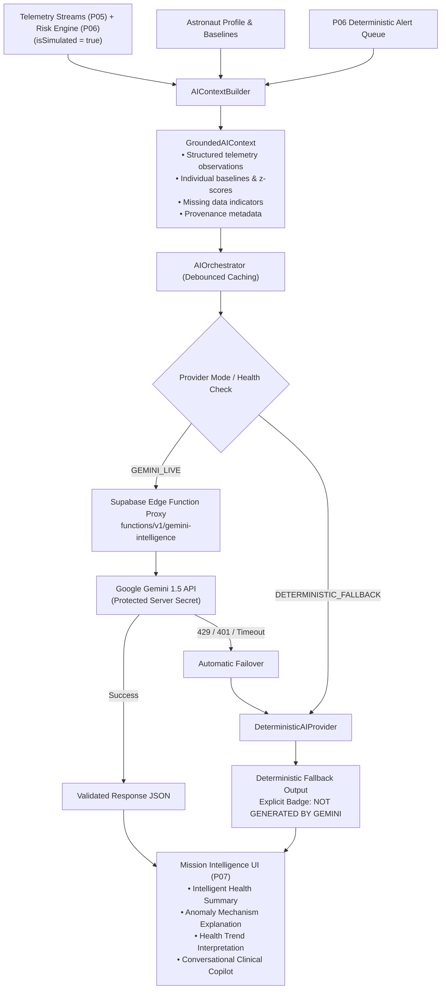

# ASTROCARE AI HEALTH INTELLIGENCE & GEMINI INTEGRATION (P07)

**Subsystem Technical Specification & Integration Guide**

---

## 1. Architectural Overview

The **AI Health Intelligence & Gemini Integration** layer introduces an evidence-grounded natural-language and physiological synthesis engine to AstroCare. It interprets existing telemetry and P06 deterministic health analytics without altering or replacing authoritative deterministic risk scores.



---

## 2. Gemini Configuration & Secure Credential Setup

### Strict Security Rules:
1. **Zero Client-Side Secret Leakage**: The client code bundle never contains `GEMINI_API_KEY` or any private secret token.
2. **Server-Side Edge Proxy**: In production, requests route through the Supabase Edge Function (`supabase/functions/gemini-intelligence/index.ts`). The API secret is stored securely in Supabase environment secrets:
   ```bash
   supabase secrets set GEMINI_API_KEY="your-gemini-api-key"
   ```
3. **Automatic Fallback Mode**: If credentials are unconfigured or unavailable, AstroCare seamlessly engages the `DeterministicAIProvider`. The interface explicitly renders the banner:
   `DETERMINISTIC FALLBACK — NOT GENERATED BY GEMINI`.

---

## 3. Provider Selection & Fallback Behavior

AstroCare supports two runtime provider modes:

| Provider Mode | Backend | Use Case | Provenance Indicator |
| :--- | :--- | :--- | :--- |
| `GEMINI_LIVE` | Google Gemini 1.5 Flash via Edge Function | Production spaceflight clinical copilot | `GEMINI 1.5 PROXY ACTIVE` |
| `DETERMINISTIC_FALLBACK` | Rule-based deterministic engine | Offline flight mode, hackathon demo, network loss | `DETERMINISTIC FALLBACK — NOT GENERATED BY GEMINI` |

### Failover Triggers:
- **Missing Credentials (401/403)**: Automatically engages fallback mode with console log warning.
- **Upstream Rate Limit (429)**: Catches Gemini quota saturation and fails over with zero UI latency.
- **Network Timeout / Abort**: Times out after 10 seconds and serves immediate grounded fallback output.

---

## 4. Grounded Context Construction & Safety Directives

The `AIContextBuilder` formats a strictly bounded schema:
- **No Hallucinations**: Only actual measurements present in the telemetry stream are included.
- **Missing Data Disclosures**: Any unavailable vital or sensor drop is explicitly flagged in `missingDataIndicators`.
- **Authority Invariance**: P06 anomaly classifications and alert severities (`CRITICAL`, `WARNING`, `CAUTION`) are non-mutating and cannot be overridden by AI outputs.
- **Non-Diagnostic Protocol**: All AI outputs represent informational clinical decision support for qualified Flight Surgeons and medical officers.

---

## 5. UI Features

1. **Intelligent Astronaut Health Summary**:
   - Executive physiological summary
   - Baseline deviations profile
   - Inter-system couplings and compounding syndromes (e.g. hypoxic tachycardia)
   - Observations requiring human review
   - Informational operational recommendations
2. **Deterministic Anomaly Explanation**:
   - Physiological mechanism explanations for active alerts
   - Clinical significance and telemetry evidence citations
   - Actionable follow-up observation advice
   - Preserves P06 alert severity labels
3. **Health Trend Interpretation**:
   - Multi-axis trajectory breakdown (`RISING`, `FALLING`, `STABLE`)
   - 4 selectable temporal windows (`1H`, `6H`, `24H`, `7D`)
   - Grounded microgravity adaptation explanations
4. **Clinical Copilot Conversational Console**:
   - Natural language queries anchored in selected astronaut telemetry
   - Suggested shortcut queries for rapid demonstration
   - Grounding citations with observed vs baseline values
   - Suggested follow-up prompts

---

## 6. Known Limitations

- **Simulated Telemetry**: All data streams derive from the virtual sensor engine (`isSimulated = true`).
- **Demo Mode**: By default, runs in deterministic fallback mode until `GEMINI_API_KEY` is supplied to the backend proxy.
