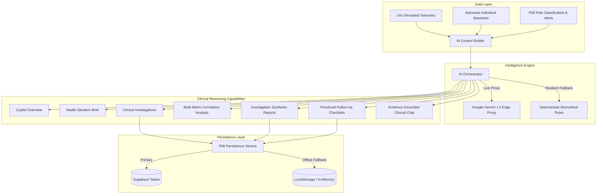

# AstroCare Clinical Reasoning Copilot & Medical Decision Support (P08)

## Architecture Overview

The Clinical Reasoning Copilot extends AstroCare with grounded physician decision-support capabilities, multi-metric correlation engines, structured case investigations, and actionable clinical follow-up checklists.

## Key Clinical Safety Guardrails
1. **Non-Autonomous Invariant**: The Copilot does not prescribe pharmaceuticals or make definitive autonomous diagnoses without authorized Flight Surgeon sign-off.
2. **Provenance Badging**: Every analytical briefing, report, and chat citation explicitly identifies its data lineage:
   - `GEMINI PROXY GROUNDED` when backed by the live Gemini proxy.
   - `DETERMINISTIC FALLBACK — NOT GENERATED BY GEMINI` when generated through deterministic aerospace medical rules.
3. **No Measurement Fabrication**: All cited vitals and deviations strictly reflect authentic telemetry and P06 baseline calculations.

## Tab Layout & UI Structure
Tabs in `IntelligencePage.tsx` follow the canonical clinical triage order:
1. **Copilot Overview**: Subject status, active anomaly count, open investigations, and priority alerts.
2. **Health Situation Brief**: Analytical horizon breakdown, telemetry observations, baseline discrepancies, and surveillance directives.
3. **Investigations**: Case management workspace to track and investigate specific biomedical anomalies.
4. **Multi-Metric Analysis**: Cross-coupling and Pearson correlation engine (e.g. compensatory hypoxic tachycardia, baroreflex).
5. **Reports**: Formal clinical synthesis reports detailing primary observations, etiologies, and information gaps.
6. **Follow-Up Checklist**: Priority-tiered clinical action items with interactive status toggles.
7. **Clinical Copilot Chat**: Conversational console featuring suggested operational queries and parameter citations.
