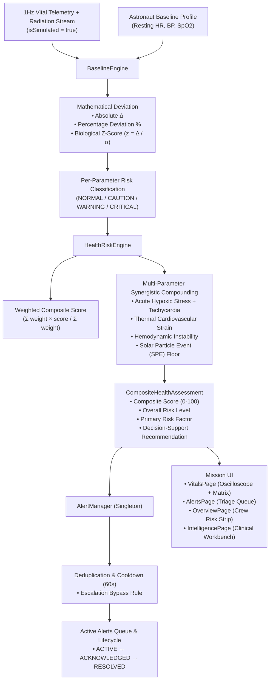

# ASTROCARE HEALTH ANALYTICS & RISK ENGINE (P06)

**Subsystem Technical Specification & Algorithmic Blueprint**

---

## 1. Architectural Overview

The **Health Analytics & Risk Engine** provides continuous physiological strain evaluation, individual baseline comparison, deterministic anomaly detection, and automated alert triage across 7 vital telemetry parameters for long-duration spaceflight crews.

---

## 2. Parameter Configurations & Baselines

All thresholds represent operational monitoring limits calibrated for microgravity environments and stress testing. They are configurable per mission profile.

| Parameter | Unit | Weight | Std Dev ($\sigma$) | Caution Low / High | Warning Low / High | Critical Low / High | Fallback Baseline |
| :--- | :--- | :--- | :--- | :--- | :--- | :--- | :--- |
| **Heart Rate** | `bpm` | `0.20` | `6.0` | $50$ / $100$ | $45$ / $130$ | $38$ / $160$ | $68\text{ bpm}$ |
| **SpO2** | `%` | `0.25` | `1.0` | $94$ / — | $90$ / — | $86$ / — | $98\%$ |
| **Systolic BP** | `mmHg` | `0.10` | `7.0` | $95$ / $135$ | $85$ / $155$ | $75$ / $175$ | $115\text{ mmHg}$ |
| **Diastolic BP** | `mmHg` | `0.08` | `5.0` | $60$ / $88$ | $50$ / $98$ | $40$ / $110$ | $75\text{ mmHg}$ |
| **Core Temp** | `°C` | `0.12` | `0.25` | $36.2$ / $37.5$ | $35.5$ / $38.5$ | $34.5$ / $39.5$ | $36.8^\circ\text{C}$ |
| **Resp Rate** | `rpm` | `0.10` | `1.5` | $9$ / $20$ | $7$ / $26$ | $5$ / $34$ | $14\text{ rpm}$ |
| **Radiation Flux** | `µSv/h` | `0.15` | `0.015` | — / $0.20$ | — / $0.80$ | — / $2.00$ | $0.052\text{ µSv/h}$ |

---

## 3. Deviation Formulas & Mathematical Invariants

For any given parameter $p$ with current observed reading $x$, individual baseline $b$, and standard deviation $\sigma$:

1. **Absolute Delta**:
   $$\Delta = x - b$$
2. **Percentage Deviation**:
   $$\%_{\Delta} = \frac{\Delta}{b} \times 100$$
3. **Biological Z-Score**:
   $$z = \frac{\Delta}{\sigma}$$

### Risk Tiers:
- **NORMAL**: $0 \le \text{Risk Score} < 25$ (deviation within physiological variability, $|z| < 2.5$)
- **CAUTION**: $25 \le \text{Risk Score} < 50$ (mild baseline elevation/depression or $|z| \ge 2.5\sigma$)
- **WARNING**: $50 \le \text{Risk Score} < 75$ (moderate physiological stress requiring operational pause)
- **CRITICAL**: $75 \le \text{Risk Score} \le 100$ (severe anomaly or life-support failure)

---

## 4. Multi-Parameter Synergistic Compounding Multipliers

Isolated threshold evaluation fails to capture dangerous multi-system physiological failures in space. The engine computes synergistic bonuses when compounding stressors coincide:

1. **Acute Hypoxic Stress (`ACUTE_HYPOXIA_COMPENSATORY_TACHYCARDIA`)**:
   - Condition: $\text{SpO2} \in \{\text{WARNING}, \text{CRITICAL}\} \land \text{HR} \in \{\text{WARNING}, \text{CRITICAL}\}$
   - Impact: $+18$ to $+25$ points; forces minimum composite score floor of $76$ when SpO2 is CRITICAL.
2. **Thermal Cardiovascular Strain (`THERMAL_CARDIOVASCULAR_STRAIN`)**:
   - Condition: $\text{Core Temp} \in \{\text{WARNING}, \text{CRITICAL}\} \land \text{HR} \in \{\text{WARNING}, \text{CRITICAL}\}$
   - Impact: $+12$ composite points.
3. **Hemodynamic Instability (`CARDIOVASCULAR_HEMODYNAMIC_INSTABILITY`)**:
   - Condition: $\text{Systolic BP} \in \{\text{WARNING}, \text{CRITICAL}\} \land \text{HR} \in \{\text{WARNING}, \text{CRITICAL}\}$
   - Impact: $+10$ composite points.
4. **Solar Particle Event (`SPE_RADIATION_EVENT_ACTIVE`)**:
   - Condition: $\text{Radiation Flux} \in \{\text{CRITICAL}\} \lor \text{solarParticleEventActive} = \text{true}$
   - Impact: Forces minimum composite score floor of $78$ and immediate CRITICAL tier flight triage.

---

## 5. Alert Deduplication & Cooldown Lifecycle

The `AlertManager` singleton prevents operational alert fatigue through strict temporal gating:

1. **Deduplication Cooldown Window**: By default, identical alert rules for the same astronaut are suppressed for $60\text{ seconds}$.
2. **Severity Escalation Bypass**: If a condition deteriorates from `HIGH` to `CRITICAL` within the cooldown window, the cooldown is immediately bypassed to ensure emergency alerts are dispatched without latency.
3. **Lifecycle States**:
   - `ACTIVE`: New alert dispatched to flight operations and mission control.
   - `ACKNOWLEDGED`: Medical officer has verified the alert; timestamps and operator credentials recorded.
   - `RESOLVED`: Condition stabilized; physiological parameters returned to baseline tolerance.

---

## 6. Scientific & Safety Disclaimers

> [!IMPORTANT]
> **SIMULATED TELEMETRY DISCLOSURE**
> All telemetry consumed by the Health Analytics & Risk Engine originates from the software-based Virtual Sensor & Telemetry Simulation Engine. All data packets are strictly marked with `isSimulated: true` and `dataSource: 'SIMULATOR'`.

> [!WARNING]
> **NON-DIAGNOSTIC DECISION SUPPORT**
> AstroCare analytics and risk scores are non-diagnostic operational decision support tools. They do not constitute official clinical diagnoses and must not replace flight surgeon clinical evaluation.

> [!NOTE]
> **THRESHOLD BENCHMARKS**
> Telemetry thresholds and standard deviations are operational engineering models designed for simulation testing and spaceflight monitoring scenarios; they are not official NASA or ESA clinical guidelines.
