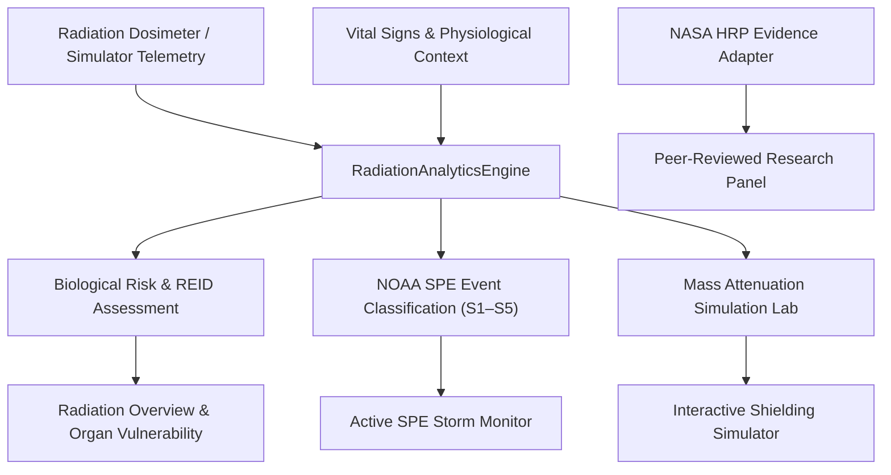

# AstroCare — Space Radiation Intelligence & Biological Risk Analytics (P09)

## 1. Overview & Operational Context
The Space Radiation Intelligence subsystem provides continuous biological risk assessment, space weather monitoring, and interactive shielding simulation for deep-space missions beyond Low Earth Orbit (LEO). Operating under the NASA Human Research Program (HRP) radiation protection guidelines, the engine computes career exposure thresholds, evaluates organ-specific vulnerability, monitors Solar Particle Events (SPE), and simulates passive habitat shielding performance.



---

## 2. NASA Permissible Exposure Limits (PEL) & Career REID

### Permissible Exposure Limit Standard
AstroCare enforces the updated NASA Standard 3001 recommendations:
- **Career Cumulative Limit:** $600\text{ mSv}$ (standard career limit bounded to maintain $<3\%$ Risk of Exposure-Induced Death / REID at the 95% confidence interval).
- **30-Day Critical Organ Limit:** $250\text{ mGy-Eq}$ for Blood-Forming Organs (BFO).
- **Annual Limit:** $500\text{ mSv}$ effective dose.

### Risk Tier Thresholds
```typescript
export function evaluateBiologicalRisk(
  accumulatedDoseMSv: number,
  ambientFluxUsVh: number,
  isSPEActive: boolean
): BiologicalRiskEvaluation
```
- **NOMINAL:** $< 100\text{ mSv}$ career, flux $< 50\ \mu\text{Sv/h}$
- **ELEVATED:** $100\text{ mSv} \le \text{dose} < 300\text{ mSv}$ or flux $\ge 50\ \mu\text{Sv/h}$
- **HIGH:** $300\text{ mSv} \le \text{dose} < 500\text{ mSv}$ or flux $\ge 250\ \mu\text{Sv/h}$
- **CRITICAL / EXCEEDED:** $\ge 500\text{ mSv}$ or flux $\ge 1000\ \mu\text{Sv/h}$ or active severe SPE

---

## 3. Organ-Specific Vulnerability Matrix

The biological risk engine evaluates four primary physiological subsystems:

| Target System | Pathophysiology / Vulnerability | Clinical Marker | Mitigation Directive |
| :--- | :--- | :--- | :--- |
| **Blood-Forming Organs (BFO)** | Hematopoietic stem cell depletion, leukopenia, immune dysfunction | ANC / Lymphocyte counts, absolute dose | Shelter retreat; prophylactic G-CSF if indicated |
| **Cardiovascular System** | Microvascular endothelial damage, accelerated atherosclerosis | Endothelial strain, BP variance | Antioxidant countermeasures, statin regimen |
| **Central Nervous System (CNS)** | Synaptic plasticity degradation, cognitive decline, microglial neuroinflammation | Cognitive flicker test, sleep architecture | Shielded sleep quarters, circadian lighting |
| **Ocular Lens** | Radiation-induced posterior subcapsular cataractogenesis | Visual acuity, contrast sensitivity | Protective visor filtration, lutein / zeaxanthin |

---

## 4. Shielding Mass Attenuation Physics

### Attenuation Formulation
AstroCare models photon and proton fluence attenuation through habitat bulkhead materials via the classical Beer-Lambert exponential mass attenuation formulation:

$$I = I_0 \cdot \exp(-\mu \cdot x)$$

Where:
- $I_0$: Incident ambient radiation flux ($\mu\text{Sv/h}$)
- $x$: Shielding thickness ($\text{g/cm}^2$ areal mass or equivalent $\text{cm}$)
- $\mu$: Material linear attenuation coefficient ($\text{cm}^{-1}$)

### Material Density & Attenuation Profiles

| Shielding Material | Density ($\text{g/cm}^3$) | Attenuation Coeff ($\text{cm}^{-1}$) | Hydrogen Richness | Relative Efficiency |
| :--- | :---: | :---: | :---: | :--- |
| **Polyethylene (HDPE)** | $0.95$ | $0.075$ | High ($14.3\%\text{ H}$ mass) | **Optimal** (minimal secondary Bremsstrahlung) |
| **Water Wall Tank** | $1.00$ | $0.065$ | High ($11.2\%\text{ H}$ mass) | **High** (multi-purpose consumable) |
| **Aluminum Bulkhead** | $2.70$ | $0.045$ | Zero | **Moderate** (produces secondary neutron scatter) |
| **Martian Regolith Sim** | $1.50$ | $0.038$ | Low | **In-situ Resource Utilization (ISRU)** |

When storm shelter mode is activated, an additional geometric and composite attenuation factor ($\times 0.35$, $65\%$ additional beam attenuation) is compounded.

---

## 5. NOAA Space Weather SPE Classification

Solar Particle Events (SPE) driven by Coronal Mass Ejections (CMEs) and solar proton acceleration are categorized under the standard NOAA Solar Radiation Storm Scale (S1 to S5):

- **S1 (Minor):** Flux $\ge 10\ \text{pfu}$ ($\sim 15\ \mu\text{Sv/h}$) — Nominal deep space monitoring
- **S2 (Moderate):** Flux $\ge 100\ \text{pfu}$ ($\sim 50\ \mu\text{Sv/h}$) — Limit non-essential EVAs
- **S3 (Strong):** Flux $\ge 1,000\ \text{pfu}$ ($\sim 250\ \mu\text{Sv/h}$) — Immediate EVA abort, seek habitat shielding
- **S4 (Severe):** Flux $\ge 10,000\ \text{pfu}$ ($\sim 1,000\ \mu\text{Sv/h}$) — Total crew muster in storm shelter
- **S5 (Extreme):** Flux $\ge 100,000\ \text{pfu}$ ($\sim 5,000\ \mu\text{Sv/h}$) — Maximum containment, supplemental water-wall deployment

---

## 6. NASA HRP Grounded Research Evidence Base

All clinical risk thresholds and mitigation recommendations are linked to grounded, peer-reviewed NASA Human Research Program publications via `NASAResearchAdapter`:

1. **NASA/TP-2013-217375:** *Risk of Radiation Carcinogenesis from Space Radiation* (Cucinotta FA et al.)
2. **NASA HRP-47065:** *Space Radiation Bio-Risk Assessment and Mitigation Model* (Huff JL et al.)
3. **NASA/SP-2009-3405:** *Human Health and Performance Risks of Space Exploration Missions* (McPhee JC, Charles JB)
4. **NASA/TP-2020-5008544:** *Radiation Countermeasures and Medical Operations in Lunar and Deep Space Operations* (Norbury JW et al.)

---

## 7. Verification & Test Suite
The radiation intelligence module is covered by automated unit tests validating:
- Exact career exposure percentage and REID threshold alerts
- Real-time biological risk level progression under SPE surges
- Exponential mass attenuation across HDPE, Water, Aluminum, and Regolith
- NOAA S1–S5 storm scale classification
- Grounded NASA HRP citation retrieval and evidence cross-linking
